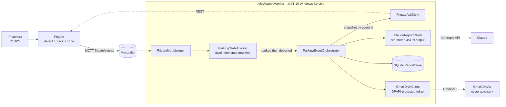

# AlleyWatch

Watches a Wyze Cam v3 alley feed via [Frigate](https://frigate.video) (Docker), and when a vehicle sits
in the alley zone longer than a configurable threshold, asks Claude for a brief report (vehicle
color/make/model, plate if legible, people getting in/out) and creates a Gmail **draft** — never sent
automatically.

> **Status: prototype.** Verification steps 1 through 4 below were completed against a live camera
> feed; step 5 (an end-to-end dry run with a real parked vehicle) was in progress when the project was
> shelved. The code builds and the unit tests pass.

## Architecture



Design choices worth noting:

- **Frigate owns computer vision; the Worker owns business logic.** Using Frigate instead of a
  hand-rolled ONNX pipeline trades a Docker dependency for far less code to maintain.
- **The dwell-time state machine is pure.** `ParkingStateTracker` takes timestamps and zone-membership
  flags from Frigate events and has no ambient clock, so it is fully unit tested
  (`tests/AlleyWatch.Tests/Tracking`).
- **Snapshots are fetched by event id over REST**, not from the per-label MQTT snapshot topic, which
  can't be tied to a specific tracked object.
- **The threshold is hot-reloaded** through `IOptionsMonitor`, so changing it needs no rebuild,
  restart, or Docker change.
- **Claude returns structured output** (JSON schema), and a `refusal` stop reason is handled
  explicitly.
- **Nothing is sent automatically.** Reports become Gmail drafts for a person to review.

### Components

- **Frigate (Docker)** owns RTSPS capture, object detection, tracking, and zone evaluation.
- **AlleyWatch.Worker** (.NET 10 Windows Service) subscribes to Frigate's MQTT events, applies the
  adjustable "how long counts as parked" threshold, calls Claude on completed park→depart events, logs
  to a local SQLite database, and creates the Gmail draft.

## License

MIT. See [LICENSE](LICENSE).

## Prerequisites

- Docker Desktop (or Docker Engine under WSL2) — **set to start automatically without requiring an
  interactive login**, since this needs to run continuously. If it can't be configured that way on this
  machine, switch to Docker Engine under WSL2 instead.
- .NET 10 SDK (already installed on this machine).
- A Wyze Cam v3 with RTSPS enabled, reachable at the URL/credentials in `docker/.env`.
- An Anthropic API key.
- A Google Cloud OAuth client (Desktop app type, Gmail API `gmail.compose` scope) — see Gmail setup below.

## Setup

### 1. Bring up Frigate + MQTT

```bash
cd docker
cp .env.example .env   # fill in your real Wyze RTSPS username/password
docker compose up -d
```

Open Frigate's web UI (`http://localhost:5000`) and confirm the live feed shows. If the stream doesn't
connect, that's almost always an ffmpeg input-args mismatch for the Wyze v3 RTSPS firmware — check
Frigate's logs (`docker compose logs frigate`) before touching anything else.

### 2. Draw the alley zone

In Frigate's web UI: **Settings → Masks & Zones**, draw the "alley_zone" polygon against the live feed
(named `alley_zone`, not `alley`, because Frigate rejects a zone sharing its camera's name), and copy the
generated coordinates into `docker/frigate/config.yml`'s `zones.alley_zone.coordinates` (replacing the
placeholder), then `docker compose restart frigate`.

### 3. Configure secrets (Claude + Gmail)

These are read from environment variables scoped to the Windows Service, not from `appsettings.json`.
After installing the service (step 5):

```powershell
Set-ItemProperty -Path 'HKLM:\SYSTEM\CurrentControlSet\Services\AlleyWatch' -Name Environment -Value @(
  'Claude__ApiKey=<your Anthropic API key>',
  'Gmail__ClientId=<OAuth client id>',
  'Gmail__ClientSecret=<OAuth client secret>'
)
```
Restart the service after setting these.

For local console-mode testing (steps 4/6/7 below) before the service is installed, set the same three
as ordinary environment variables in your shell instead.

### 4. Gmail OAuth — one-time interactive consent

Run this **once**, interactively, as the exact Windows user account the service will later log on as
(see "Windows Service account" below for why that matters):

```bash
dotnet run --project src/AlleyWatch.Worker -- --auth-gmail
```

This opens a browser for Gmail consent (scope: `gmail.compose`) and stores a DPAPI-protected refresh
token under `data/gmail-token/`.

### 5. Install as a Windows Service

```powershell
dotnet publish src/AlleyWatch.Worker -c Release -o publish
sc create AlleyWatch binPath= "C:\path\to\publish\AlleyWatch.Worker.exe"
```

**Windows Service account**: the service must log on as the *same* Windows user account that ran
`--auth-gmail` in step 4 — the refresh token is DPAPI-protected at `CurrentUser` scope, so a different
account can't decrypt it. Set this in `services.msc` → AlleyWatch → Log On tab.

## Adjusting the "parked" threshold

Edit `Parking:ParkedThresholdMinutes` in `src/AlleyWatch.Worker/appsettings.json` (default 10). This is
read via `IOptionsMonitor`, so it takes effect on the next config reload — no rebuild, no restart, and it
never requires touching Frigate/Docker config.

## Verification (work through in order before trusting this unattended)

1. **Docker/Frigate stands up** — `docker compose up`, confirm the web UI shows the live feed.
2. **Zone + detection sanity** — draw the zone, park a car, confirm Frigate's own UI shows it tracked and zoned.
3. **MQTT wiring** — `mosquitto_sub -h localhost -t frigate/events` (or any MQTT client) confirms events are flowing.
4. **Unit tests** — `dotnet test` (the `ParkingStateTrackerTests` suite covers the dwell-time state machine).
5. **Shortened-threshold live dry run** — set `ParkedThresholdMinutes` to `0.1` temporarily, run in console mode
   (`dotnet run --project src/AlleyWatch.Worker`), actually park a car. Confirms Frigate→MQTT→state-machine wiring.
6. **Claude dry run** — `dotnet run --project src/AlleyWatch.Worker -- --dry-run-claude <folder-of-jpegs>`.
7. **Gmail dry run** — `dotnet run --project src/AlleyWatch.Worker -- --test-gmail-draft`, confirm a placeholder
   draft appears in Gmail Drafts and nothing was sent.
8. **Frigate/Docker resilience** — restart the `frigate` container while the Worker runs; confirm the MQTT
   listener reconnects without the Worker crashing.
9. **Full live validation** — install as a real Windows Service, run against the real alley for a day or two,
   review a handful of reports and drafts for accuracy before relying on it unattended.

## Known items to revisit

- `FrigateApiClient`'s endpoint paths (`/api/events/{id}/snapshot.jpg`) are the long-standing Frigate
  convention but weren't confirmed against a live docs fetch for this build — verify against the
  installed Frigate version's own API docs page (its web UI ships one) if snapshot fetches ever 404.
- NuGet reports a known high-severity advisory on `SQLitePCLRaw.lib.e_sqlite3` 2.1.11, pulled in
  transitively by `Microsoft.Data.Sqlite` 10.0.10 (the current version at time of writing). Worth
  checking for an updated `Microsoft.Data.Sqlite` release that bumps this dependency before going live.
- Frigate's `input_args: preset-rtsp-restream` on the camera config is a starting point, not confirmed
  against the Wyze Cam v3's specific RTSPS firmware quirks — step 1 above is exactly where this gets
  tested for real.
